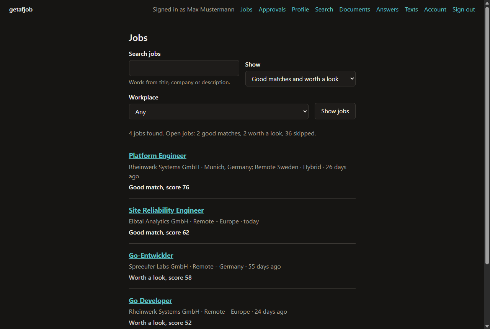
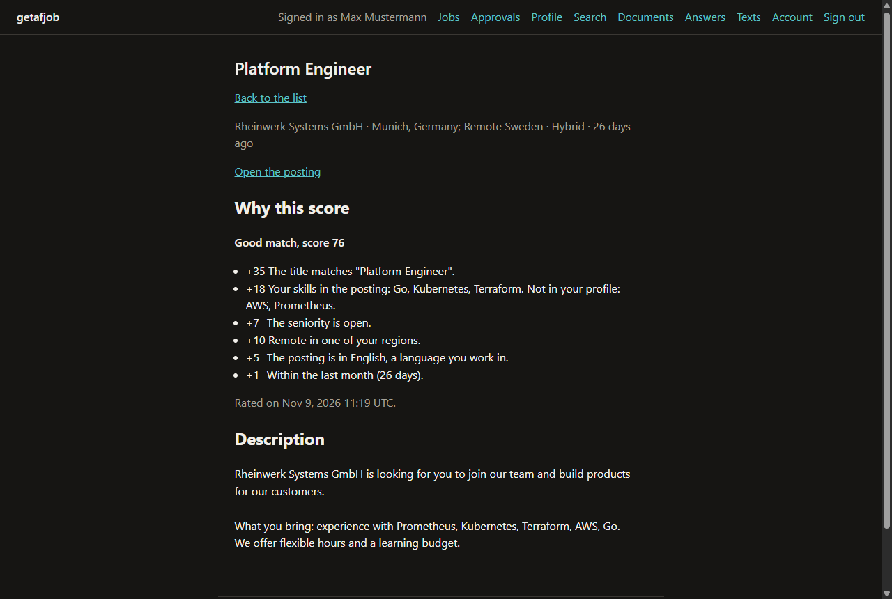
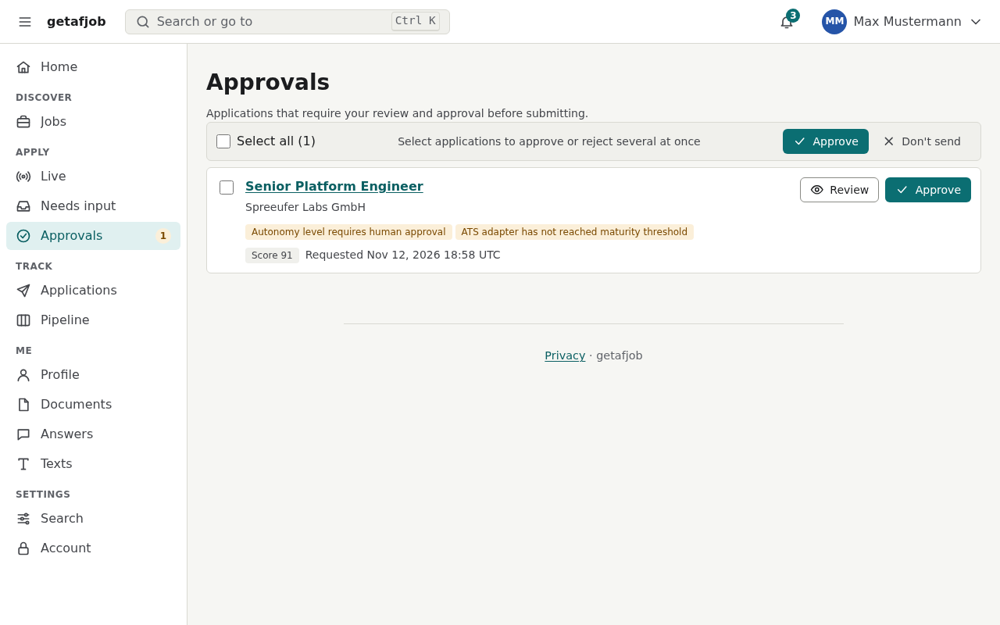
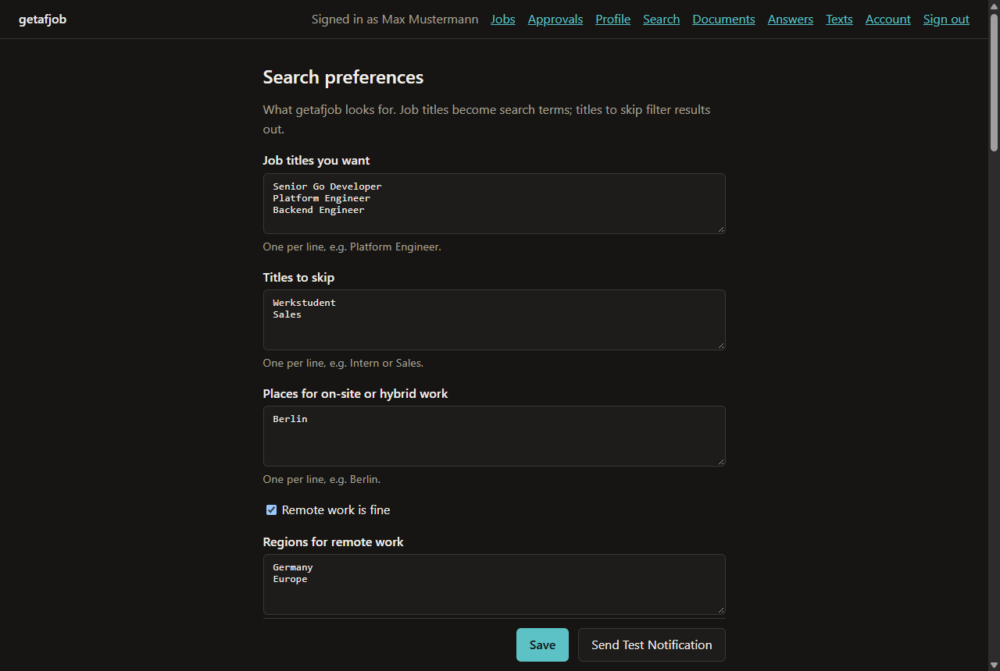
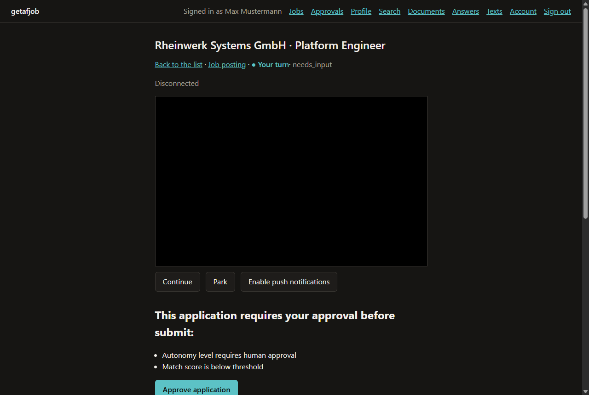
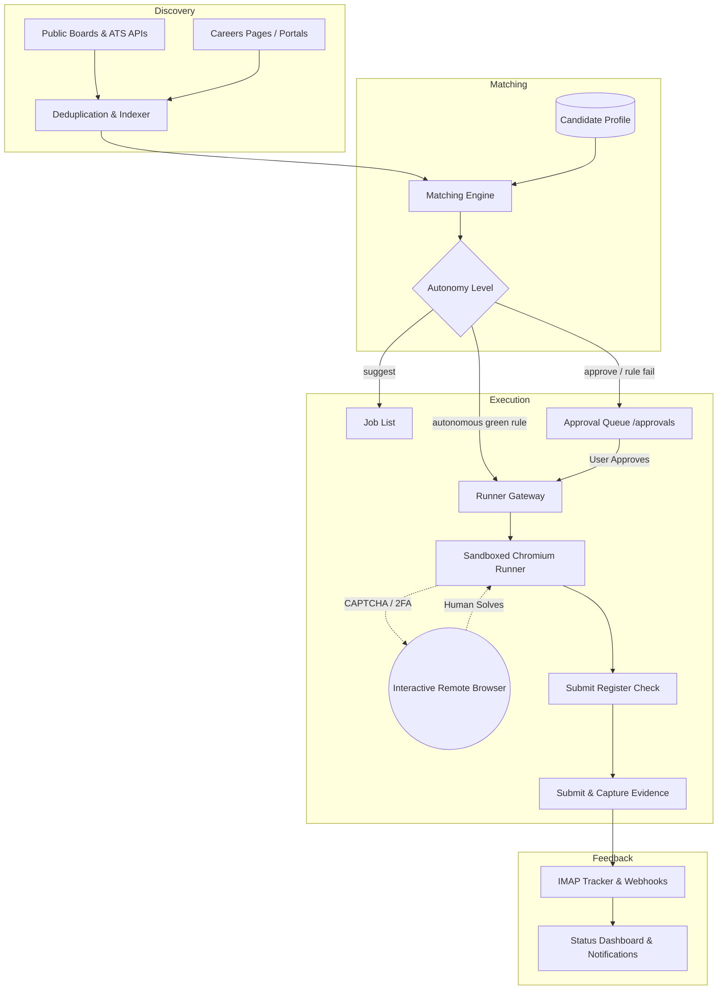
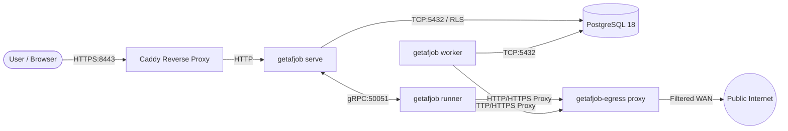

<div align="center">

# getafjob

**Autonomous job search and application engine written in Go.**

Collects job postings, scores them per candidate profile, and fills out application forms in a real sandboxed Chromium browser with human approval gates.

[](https://github.com/1xxn/getafjob/actions/workflows/ci.yml)
[](https://github.com/1xxn/getafjob/actions/workflows/codeql.yml)
[](https://scorecard.dev/viewer/?uri=github.com/1xxn/getafjob)
[](https://www.bestpractices.dev/projects/16347)
[](https://pkg.go.dev/github.com/1xxn/getafjob)
[](go.mod)
[](LICENSE)

[Features](#features) · [Screenshots](#screenshots) · [How It Works](#how-it-works) · [Quickstart](#quickstart) · [Administration CLI](#administration-cli) · [Operations](#operations) · [Security & Privacy](#security--privacy) · [Roadmap](#roadmap)

</div>

---

## Overview

`getafjob` is a self-hosted, multi-user automation platform that handles the repetitive mechanics of job seeking. It crawls public ATS boards and job feeds, ranks openings deterministically against your structured profile, and drives a real headless browser to fill out multi-step application forms without submitting duplicates or generating unreviewed content.

### Core Principles
- **No Cover Letters:** Enforced strictly across the pipeline. We do not generate, template, or attach cover letters.
- **Full Traceability:** Every filled field is linked to an explicit fact in your profile or an approved answer bank entry.
- **Zero Stealth / No Bot Disguise:** No browser fingerprint spoofing, no CAPTCHA-solving sweatshops. Bot challenges and 2FA prompts route directly to an interactive remote browser window for human completion.
- **Defense in Depth:** Outbound network requests pass through an SSRF-filtering egress proxy; browser sessions run inside dedicated unprivileged Linux containers with seccomp filtering; multi-tenant database access is isolated by PostgreSQL Row-Level Security.

---

## Features

- **Broad ATS & Board Collection:**
  - Native API & scrapers for 10+ ATS platforms: Greenhouse, Ashby, Lever, Workday, SmartRecruiters, Personio, Recruitee, Workable, Teamtailor, and Eightfold.
  - Job boards & public search: Bundesagentur für Arbeit, Arbeitnow, Himalayas, and public portal search for LinkedIn, Indeed, and Glassdoor.
  - Automatic detection of schema.org `JobPosting` and sitemaps on custom company career sites.
  - Built-in tech employer catalog, conditional ETag requests, and deduplication into a unified index.

- **Deterministic Scoring Engine:**
  - Evaluates postings against target titles, seniority, skills, locations, remote region preferences, work authorization, salary expectations, and language proficiencies.
  - Every match score is accompanied by a transparent, point-by-point breakdown explaining exactly why a posting ranked high or low.

- **Real Browser Automation:**
  - Headless Chromium controlled via `go-rod` inside hardened runner containers.
  - Handles nested and out-of-process iframes (OOPIF), Shadow DOM, custom ARIA widgets (`role="combobox"`, `role="listbox"`, toggles), drag-and-drop file upload zones, and multi-step wizard flows.
  - Centralized **submit register** enforcing at most one submission per application to prevent accidental duplicate applications.

- **Configurable Autonomy & Approvals:**
  - Three distinct autonomy tiers:
    - `suggest`: Discovers and scores jobs; candidate triggers runs manually.
    - `approve` *(Default)*: Automatically prepares and fills forms, then halts at `BeginSubmit` for review in the approval queue.
    - `autonomous`: Submits automatically only when all 11 green rules pass (verified board, score threshold, salary fit, known fields).
  - Web approval queue (`/approvals`) for inspecting form values, attached documents, and confidence metrics before giving the final submit click.

- **Interactive Remote Screencast:**
  - Live low-latency WebSocket screencast (`/applications/{id}`) to interact with the runner browser when CAPTCHAs, bot challenges, or email verification codes appear.

- **Status Tracking & Pacing:**
  - RFC 3501 read-only IMAP tracking worker to detect confirmation emails, status changes, and interview invitations without reading private emails.
  - Rate limiting, daily submission quotas (default max 5/day), host gap throttling, and quiet-hours enforcement.
  - Multi-channel notification delivery: Web Push (RFC 8291/8292 VAPID), SMTP email, and ntfy.

- **Security & Multi-Tenancy:**
  - Passwordless authentication with Passkeys (WebAuthn / FIDO2) and delayed recovery magic links.
  - PostgreSQL Row-Level Security (RLS) on all tenant tables, audited by automated architecture tests.
  - Envelope encryption (`crypto.Envelope`) using per-user keys for sensitive documents and stored portal sessions.
  - Full GDPR compliance: Art. 17 right to erasure with cryptographic key shredding (`Forget`), Art. 20 ZIP data portability export, and automated 90-day screenshot retention pruning.

---

## Screenshots

All screens rendered from invented demo data (`getafjob admin demo`) using server-side templates with `templ` and `htmx 4` under a strict Content Security Policy.

<p align="center">
  
  
</p>
<p align="center">
  <em>Left: Scored job feed with search, workplace filters, and match categories.<br>
  Right: Transparent score breakdown showing positive and negative weighting factors.</em>
</p>

<p align="center">
  
  
</p>
<p align="center">
  <em>Left: Approval list holding pre-filled applications for human sign-off before submit.<br>
  Right: Search preferences, title exclusions, remote regions, and autonomy level configuration.</em>
</p>

<p align="center">
  
</p>
<p align="center">
  <em>Application evidence view with interactive remote browser frame and human-in-the-loop controls.</em>
</p>

---

## How It Works



### Binary Architecture
`getafjob` compiles into a single static Go binary with subcommands:
- `serve`: Web interface, HTTP API, and gRPC runner gateway.
- `worker`: Background River job queue processing crawls, matching passes, IMAP tracking, and retention cleanups.
- `runner`: Outbound-only browser execution agent driving headless Chromium. Operates with zero database access.
- `migrate`: Database schema migration tool (runs with database owner privileges).
- `admin`: Operational CLI for user invitations, demo seeding, load testing, and maintenance.

### Network Topology


---

## Quickstart

### Prerequisites
- **Go 1.27.3+**
- **Docker** with **Docker Compose v2**
- All development and build tools are pinned in `go.mod` and run via `go tool task`.

### 1. Clone & Start Local Development Stack
```bash
git clone https://github.com/1xxn/getafjob.git
cd getafjob

# Creates dev secrets, builds container images, and starts all services
go tool task dev:up

# Verify health endpoint
curl -k https://localhost:8443/healthz
```

### 2. Create Initial Admin Account
All local development emails are captured by the built-in Mailpit instance (`http://127.0.0.1:8025`).
```bash
docker compose -f deploy/compose.yaml exec serve \
  getafjob admin invite -email max.mustermann@example.com -role admin -send
```
Open Mailpit in your browser, click the invitation link, choose your display name, and register your passkey.

### 3. Seed Synthetic Demo Data
To explore the complete UI immediately without waiting for background crawls:
```bash
docker compose -f deploy/compose.yaml exec serve \
  getafjob admin demo -jobs 2000
```
This populates the database with 2,000 synthetic job listings and matches them against demo candidate profiles.
Add `-fixtures http://fixtures:8080` to point the postings at the local fixture site: in the development stack the
runner has its own egress proxy that reaches only that site, so runs can be watched end to end without touching a
real job site.

### 4. Trigger Discovery Crawl
```bash
# Import the built-in tech employer catalog
docker compose -f deploy/compose.yaml exec worker getafjob admin boards import

# Trigger an immediate crawl run
docker compose -f deploy/compose.yaml exec worker getafjob admin crawl
```

To stop the development environment:
```bash
go tool task dev:down
```

---

## Administration CLI

The binary includes administrative commands for cluster and operational maintenance:

```bash
# Seed development data with synthetic profiles
getafjob admin demo [-jobs 2000] [-seed 1]

# Issue account invitations
getafjob admin invite -email <addr> -role <admin|user> [-send]

# Import or sync company boards
getafjob admin boards import
getafjob admin crawl [-sources greenhouse,ashby,lever]

# User privacy & GDPR operations
getafjob admin export-user -email <addr> -out <export.zip>
getafjob admin delete-user -email <addr>

# System maintenance & retention pruning
getafjob admin cleanup

# Load testing against SLOs
getafjob admin load-test -url https://localhost:8443 -users 10 -duration 30s
```

---

## Operations

### Observability
The stack provides an integrated Prometheus, Grafana, Loki, and Tempo profile for distributed tracing and performance metrics:

```bash
# Launch the observability profile (Grafana on http://localhost:3000)
go tool task obs:up

# Generate concurrent synthetic load to verify dashboard SLOs
go tool task obs:load

# View service logs
go tool task obs:logs
```

Key monitored metrics include:
- `getafjob.run.step.duration`: Step latency histogram partitioned by ATS adapter and step (`prepare`, `extract`, `plan`, `execute`, `verify`, `submit`).
- `getafjob.ats.maturity`: Adapter success rate and readiness tracker.
- `getafjob.http.server.duration`: Endpoint latency tracking the p95 < 200 ms dashboard SLO.

### Backups & Disaster Recovery
Automated client-side encrypted backups using `restic`:
```bash
# Create an encrypted snapshot of PostgreSQL and blob store volumes
go tool task backup

# Rehearse recovery drill against a throwaway container
go tool task test:restore
```
Runbook available at [`docs/runbooks/backup-restore.md`](docs/runbooks/backup-restore.md).

---

## Security & Privacy

- **OWASP ASVS Verification:** Fully audited against OWASP ASVS 4.0/5.0 Level 2 in [`docs/security.md`](docs/security.md).
- **Tenant Isolation:** Enforced via PostgreSQL Row-Level Security (`current_setting('app.current_user_id')`) and tested in CI via [`internal/archtest`](internal/archtest).
- **Cryptographic Erasure (GDPR Art. 17):** Account deletion zeros and destroys the user's master key envelope (`crypto.Envelope.Forget`), rendering all historical backups mathematically unreadable.
- **SSRF Defense:** All external crawls and browser runner traffic are mediated by `netguard` and `getafjob-egress`, strictly blocking loopback (`127.0.0.1`), RFC 1918 private subnets, and cloud metadata endpoints (`169.254.169.254`).
- **Chromium Sandboxing:** Runner containers drop all Linux capabilities (`cap_drop: [ALL]`), enforce `no-new-privileges`, and run with a custom seccomp profile (`deploy/seccomp/chromium.json`).

Please report security issues responsibly per [`SECURITY.md`](SECURITY.md).

---

## Roadmap

All planned milestone phases have been completed and verified:

| Phase | Milestone | Scope | Status |
|---|---|---|---|
| [Phase 0](https://github.com/1xxn/getafjob/milestone/1) | **Foundation** | Single binary, Compose stack, CI/CD, threat model, go-rod spike | ✅ Done |
| [Phase 1](https://github.com/1xxn/getafjob/milestone/2) | **Users, Profile, Jobs** | Passkeys, magic links, RLS, discovery index, deterministic matching, web UI | ✅ Done |
| [Phase 2](https://github.com/1xxn/getafjob/milestone/3) | **Applying** | State machine, submit register, 8 primary ATS adapters, Chromium runner | ✅ Done |
| [Phase 3](https://github.com/1xxn/getafjob/milestone/4) | **Autonomy** | Autonomy tiers, pacing, approval queue, IMAP tracking, notifications, MV3 extension | ✅ Done |
| [Phase 4](https://github.com/1xxn/getafjob/milestone/5) | **Portals & Hardening** | Easy Apply, optional AI helper, ASVS L2, load testing, encrypted backups, deploy pipeline | ✅ Done |
| [Phase 5](https://github.com/1xxn/getafjob/milestone/6) | **Live Test & Dry Runs** | 22 browser dry runs across all ATS adapters, 0 leaks, comprehensive report | ✅ Done |

See [`docs/reports/phase-5-live-test.md`](docs/reports/phase-5-live-test.md) for the live testing report.

---

## Development

All standard tasks are orchestrated through `Taskfile.yml`:

```bash
go tool task check          # fmt, vet, golangci-lint, tests with -race, govulncheck, diff
go tool task test:short     # Fast unit test pass
go tool task test:browser   # Browser test suite inside runner image with seccomp sandbox
go tool task generate       # Re-run buf, oapi-codegen, templ, and sqlc generators
```

Contributions must follow the rules in [`CONTRIBUTING.md`](CONTRIBUTING.md): fictional candidate data only, Conventional Commits, and verified quality gates.

---

## License

[MIT](LICENSE). Third-party software notices are cataloged in [THIRD_PARTY_NOTICES](THIRD_PARTY_NOTICES).
