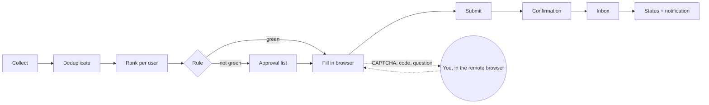

<div align="center">

# getafjob

**Finds jobs, ranks them for you and applies in a real browser – honestly.**

[](https://github.com/1xxn/getafjob/actions/workflows/ci.yml)
[](https://github.com/1xxn/getafjob/actions/workflows/codeql.yml)
[](https://scorecard.dev/viewer/?uri=github.com/1xxn/getafjob)
[](https://goreportcard.com/report/github.com/1xxn/getafjob)
[](https://pkg.go.dev/github.com/1xxn/getafjob)
[](go.mod)
[](LICENSE)

[Features](#features) · [How it works](#how-it-works) · [Quickstart](#quickstart) · [Roadmap](#roadmap) ·
[Architecture](docs/architecture.md) · [Security](docs/security.md)

</div>

> [!WARNING]
> **Early development.** Phase 0 (foundation) is complete; getafjob does not apply to jobs yet. Follow the
> [roadmap](#roadmap) and the [project board](https://github.com/users/1xxn/projects/1).

## Features

- 🔎 **Collects on its own** – ATS boards (Greenhouse, Lever, Ashby, Workday, SmartRecruiters, Personio, Recruitee,
  Workable), job boards and careers pages; one global index, deduplicated, with history.
- 📊 **Ranks per user, with reasons** – role, seniority, skills, location/remote, language, salary and recency.
- 🖥️ **Applies in a real browser** – fills forms with go-rod and Chromium: iframes, shadow DOM, custom selects,
  drop zones, multi-step forms.
- 🧾 **Never invented, never twice** – every value names its source; a submit register in the database makes a
  second submission impossible; every application keeps its evidence.
- 🙋 **Humans handle human checks** – CAPTCHAs, bot checks and security codes go to you through a remote browser
  view. No stealth plugins, no fingerprint spoofing, no CAPTCHA services.
- 🎚️ **Your level of autonomy** – suggest · fill in and approve (default) · fully autonomous by rule.
- 🔐 **Multi-user, invite-only, self-hosted** – passkeys, row-level security, encrypted documents, isolated
  browser runners behind an egress proxy.
- 🤖 **AI optional** – everything works without it; an optional module uses the Anthropic API per user.

## How it works



One Go binary runs as `serve` (web UI, API, runner gateway), `worker` (queue jobs), `runner` (Chromium, no
database access), `migrate` and `admin`, next to PostgreSQL 18, Caddy and an egress proxy in Docker Compose.
Decisions are recorded as [ADRs](docs/adr/README.md).

## Quickstart

Requirements: **Go 1.27.3** and **Docker** with Compose. Every other tool is pinned in `go.mod` and runs with
`go tool`.

```bash
git clone https://github.com/1xxn/getafjob.git && cd getafjob
go tool task dev:up       # dev secrets, images, all services – waits until every one is healthy
curl -k https://localhost:8443/api/v1/meta
go tool task dev:down
```

## Development

```bash
go tool task --list         # every command
go tool task check          # fmt, vet, golangci-lint, tests with -race, govulncheck, generated code
go tool task test:browser   # browser tests inside the runner image (Chromium sandbox on)
go tool task hooks          # git hooks (lefthook)
```

See [CONTRIBUTING.md](CONTRIBUTING.md) – fictional data only, Conventional Commits, one focused PR per issue.

## Roadmap

| Phase | Scope | Status |
|---|---|---|
| [0 – Foundation](https://github.com/1xxn/getafjob/milestone/1) | binary, Compose stack, CI/CD, docs, go-rod spike | ✅ done |
| [1 – Users, profile, jobs](https://github.com/1xxn/getafjob/milestone/2) | identity, profile, discovery, matching, UI | ⏳ next |
| [2 – Applying](https://github.com/1xxn/getafjob/milestone/3) | runner engine, ATS adapters, remote browser, evidence | |
| [3 – Autonomy](https://github.com/1xxn/getafjob/milestone/4) | rules, quotas, inbox tracking, notifications, extension | |
| [4 – Portals, AI, hardening](https://github.com/1xxn/getafjob/milestone/5) | portal search, optional AI, ASVS review, deploy | |
| [5 – Live test](https://github.com/1xxn/getafjob/milestone/6) | dry runs and supervised real applications | |

## Security

Signed images and releases (cosign, SBOM, build provenance), pinned dependencies and actions, CodeQL, Trivy and
govulncheck on every pull request. Threat model: [docs/security.md](docs/security.md). Please report
vulnerabilities privately – see [SECURITY.md](SECURITY.md).

## License

[MIT](LICENSE) · [Third-party notices](THIRD_PARTY_NOTICES)
