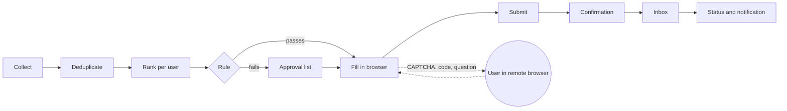

<div align="center">

# getafjob

Collects job postings, ranks them per user and fills out applications in a real browser.

[](https://github.com/1xxn/getafjob/actions/workflows/ci.yml)
[](https://github.com/1xxn/getafjob/actions/workflows/codeql.yml)
[](https://scorecard.dev/viewer/?uri=github.com/1xxn/getafjob)
[](https://www.bestpractices.dev/projects/16347)
[](https://pkg.go.dev/github.com/1xxn/getafjob)
[](go.mod)
[](LICENSE)

[Features](#features) · [How it works](#how-it-works) · [Quickstart](#quickstart) · [Roadmap](#roadmap) ·
[Architecture](docs/architecture.md) · [Security](docs/security.md)

</div>

> [!NOTE]
> Early development. Phase 0 (foundation) is complete; getafjob does not apply to jobs yet. See the
> [roadmap](#roadmap) and the [project board](https://github.com/users/1xxn/projects/1).

## Features

- **Job collection** from ATS boards (Greenhouse, Lever, Ashby, Workday, SmartRecruiters, Personio, Recruitee,
  Workable, Eightfold), job boards (Arbeitnow, Himalayas, Bundesagentur für Arbeit), the career sites of Google,
  Apple and Amazon, and careers pages, in one deduplicated index with history. A built-in catalog lists tech
  employers with remote or Germany jobs, each checked against its live API.
- **Ranking per user** with reasons: role, seniority, skills, location and remote, language, salary, recency.
- **Applications in a real browser** with go-rod and Chromium, including iframes, shadow DOM, custom selects,
  drop zones and multi-step forms.
- **Traceable values.** Every form value names its source, and every application keeps its evidence: values,
  sources, a screenshot before submitting and the confirmation page.
- **No duplicate submissions.** A submit register in the database allows one submission per application.
- **Checks stay with people.** CAPTCHAs, bot checks and security codes are handed to the user in a remote browser
  view. No stealth plugins, no fingerprint spoofing, no CAPTCHA services.
- **Autonomy levels** per user: suggest, fill in and wait for approval (default), or apply by rule.
- **Multi-user and self-hosted**: invite-only, passkeys, row-level security, encrypted documents, isolated browser
  runners behind an egress proxy.
- **AI is optional.** Everything works without it; an optional module uses the Anthropic API per user.

## How it works



One Go binary runs as `serve` (web UI, API, runner gateway), `worker` (queue jobs), `runner` (Chromium, no
database access), `migrate` and `admin`. PostgreSQL 18, Caddy and an egress proxy complete the Docker Compose stack.
Design decisions are recorded as [ADRs](docs/adr/README.md).

## Quickstart

Requirements: Go 1.27.3 and Docker with Compose. All other tools are pinned in `go.mod` and run with `go tool`.

```bash
git clone https://github.com/1xxn/getafjob.git && cd getafjob
go tool task dev:up       # creates dev secrets, builds images, starts all services and waits until they are healthy
curl -k https://localhost:8443/api/v1/meta
go tool task dev:down
```

The first account needs an invitation. Locally all mail lands in Mailpit (http://127.0.0.1:8025):

```bash
docker compose -f deploy/compose.yaml exec serve getafjob admin invite -email max.mustermann@example.com -role admin -send
```

## Development

```bash
go tool task --list         # all commands
go tool task check          # fmt, vet, golangci-lint, tests with -race, govulncheck, generated code
go tool task test:browser   # browser tests inside the runner image (Chromium sandbox on)
go tool task hooks          # git hooks (lefthook)
```

See [CONTRIBUTING.md](CONTRIBUTING.md): fictional data only, Conventional Commits, one focused pull request per
issue.

## Roadmap

| Phase | Scope | Status |
|---|---|---|
| [0: Foundation](https://github.com/1xxn/getafjob/milestone/1) | binary, Compose stack, CI/CD, docs, go-rod spike | done |
| [1: Users, profile, jobs](https://github.com/1xxn/getafjob/milestone/2) | identity, profile, discovery, matching, UI | in progress |
| [2: Applying](https://github.com/1xxn/getafjob/milestone/3) | runner engine, ATS adapters, remote browser, evidence | planned |
| [3: Autonomy](https://github.com/1xxn/getafjob/milestone/4) | rules, quotas, inbox tracking, notifications, extension | planned |
| [4: Portals, AI, hardening](https://github.com/1xxn/getafjob/milestone/5) | portal search, optional AI, ASVS review, deploy | planned |
| [5: Live test](https://github.com/1xxn/getafjob/milestone/6) | dry runs and supervised real applications | planned |

## Security

Images and releases are signed (cosign) and ship with an SBOM and build provenance. Dependencies and actions are
pinned; CodeQL, Trivy and govulncheck run on every pull request. Threat model: [docs/security.md](docs/security.md).
Please report vulnerabilities privately, see [SECURITY.md](SECURITY.md).

## License

[MIT](LICENSE). Third-party notices: [THIRD_PARTY_NOTICES](THIRD_PARTY_NOTICES).
