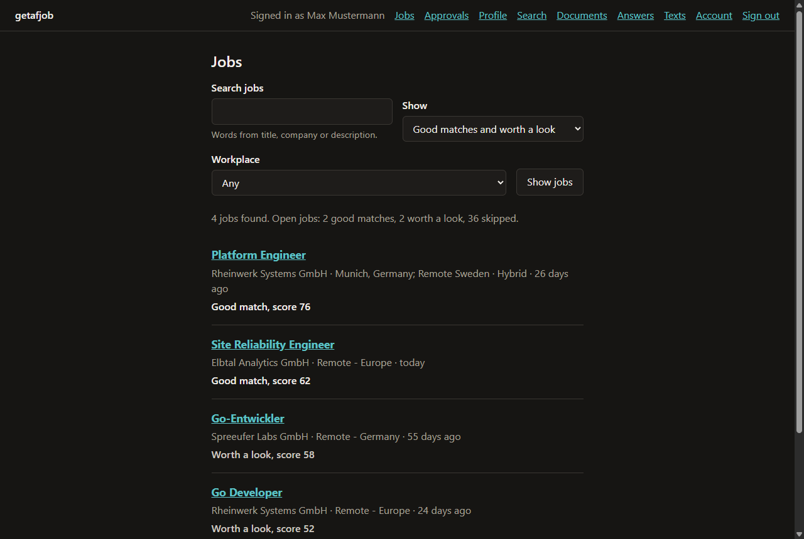
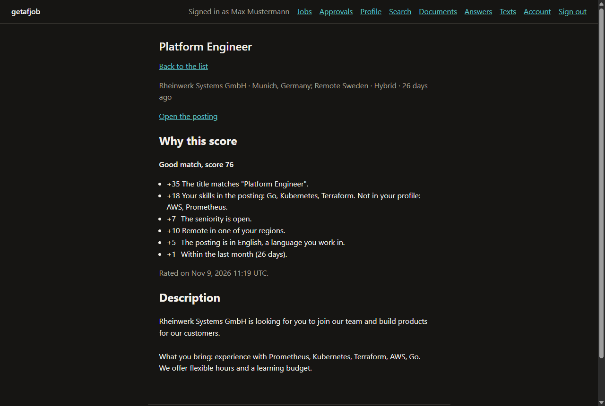
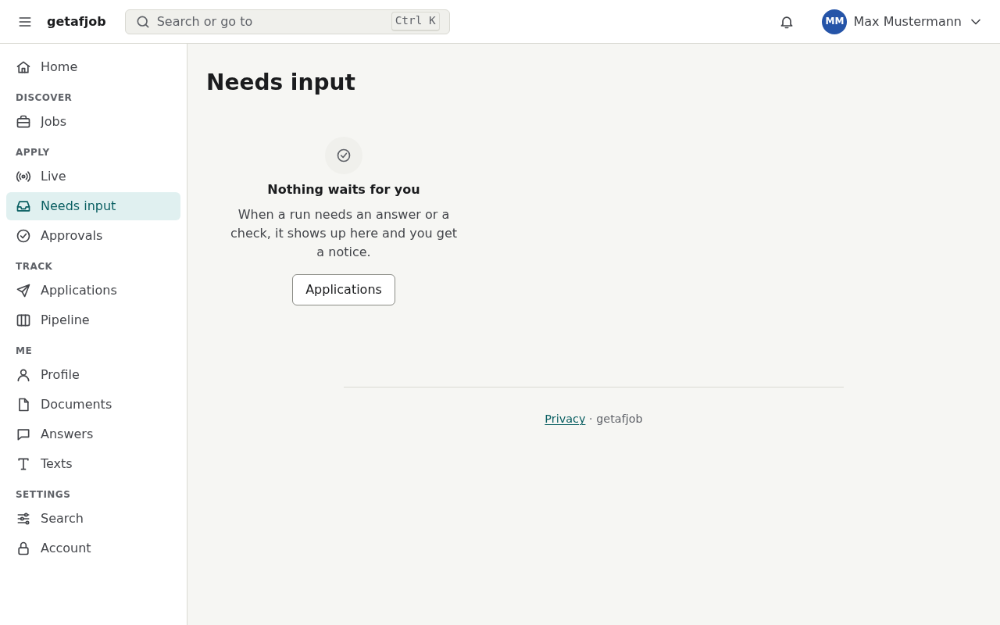
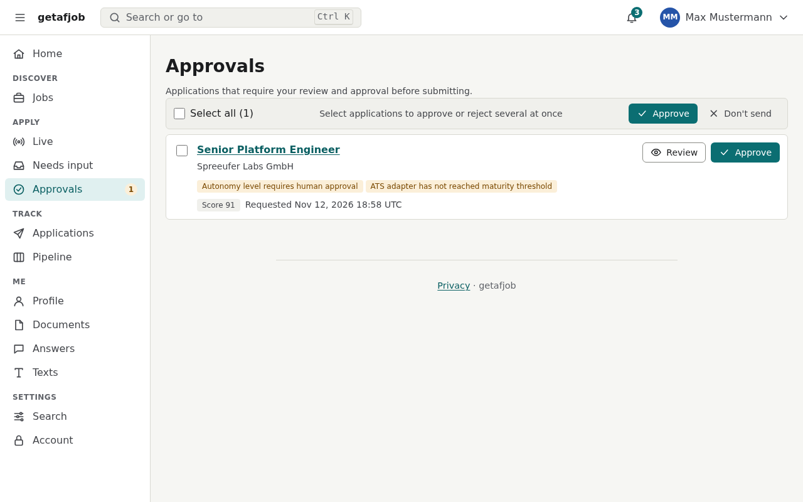
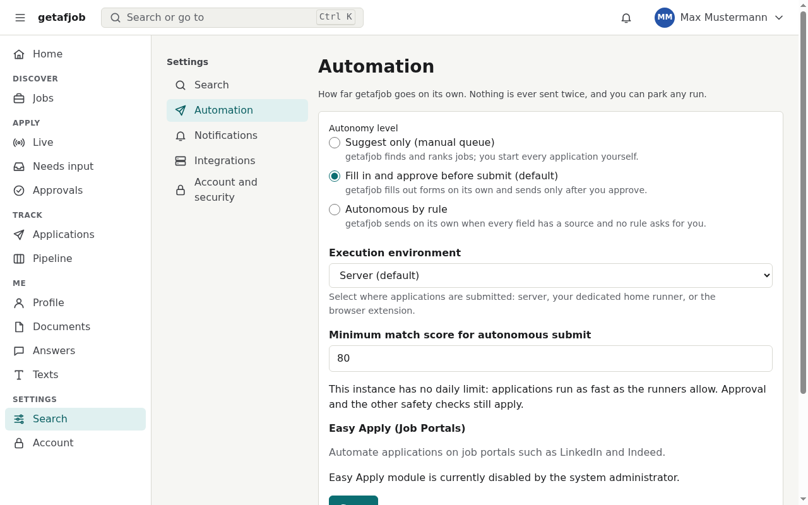

# getafjob

Self-hosted multi-user job discovery, matching, and browser application tool written in Go.

[](https://github.com/1xxn/getafjob/actions/workflows/ci.yml)
[](go.mod)
[](LICENSE)

`getafjob` collects job postings from ATS boards and public job feeds, ranks them against each user's structured profile and search preferences, and fills out application forms in a real headless Chromium browser while keeping the user in control of submissions, logins, and bot checks.

## Screenshots

Generated from demo fixtures via `go tool task docs:screenshots`.

<p align="center">
  
  
</p>
<p align="center">
  
  
</p>
<p align="center">
  
</p>

## What it does

- **Discovery (`internal/discovery`)**: Crawls company ATS boards (`Greenhouse`, `Ashby`, `Lever`, `SmartRecruiters`, `Personio`, `Recruitee`, `Workable`, `Workday`, `Softgarden`, `JOIN`, `SAP SuccessFactors`, `Eightfold`), company sitemaps and career pages (`schema.org/JobPosting`), public job feeds (`Arbeitnow`, `Arbeitsagentur`, `BerlinStartupJobs`, `Himalayas`), major career sites (`Amazon`, `Apple`, `Google`), and optional portal searches (`LinkedIn`, `Indeed`, `Glassdoor`). Uses conditional HTTP requests (`ETag`/`Last-Modified`) and deduplicates postings into a shared index.
- **Deterministic + Local Semantic Matching (`internal/matching`)**: Applies hard constraints (titles, exclusions, seniority, location, remote/hybrid policy, salary floor, language) and ranks jobs with transparent per-reason point breakdowns. Optionally combines rule scores with an in-process quantized static token embedding model (`static-similarity-mrl-multilingual-v1`, 256 `float16` dimensions, ~55 MB in memory, runs in-process on CPU).
- **Browser Runner & Guardrails (`internal/runner`, `internal/application`)**: Uses `go-rod` and headless Chromium inside a sandboxed container to fill multi-step forms, nested iframes, Shadow DOM, and file uploads.
  - No stealth or anti-fingerprinting plugins (`go-rod/stealth` is forbidden in `.golangci.yml`).
  - No cover-letter generation; every filled value requires tracked provenance from the user's profile or approved answer bank.
  - A unique `submit_register` prevents duplicate submissions across retries and crashes.
  - Three autonomy levels (`suggest` by default, `approve`, `autonomous`), daily limits, and an approval queue (`/approvals`).
  - CAPTCHAs, sign-ins, 2FA prompts, and unknown questions pause the run for interactive completion over a WebSocket browser screencast (`/needs-input`).
- **Inbox Tracking & Notifications (`internal/tracking`, `internal/notify`)**: Read-only IMAP scanning matches confirmations, rejections, and interview requests (explicitly ignoring verification/security codes). Supports Web Push (VAPID), SMTP email, and ntfy.
- **Tenant Isolation & Encryption**: Invite-only Passkey (WebAuthn) sign-in with delayed magic-link recovery; PostgreSQL Row-Level Security (`getafjob_app`); per-user AES-256-GCM envelope encryption for documents and secrets (`admin export-user`, `admin delete-user` crypto-shredding); SSRF filtering via `internal/platform/netguard` and a `smokescreen` egress proxy.

## Quickstart (Local Stack)

Prerequisites: **Go 1.27+** (`1.27.4` in [go.mod](go.mod)) and **Docker** with Compose v2.

```bash
git clone https://github.com/1xxn/getafjob.git
cd getafjob

# Generate local secrets, build images, start all services, and wait until healthy
go tool task dev:up
```

Load invented demo data (or create an admin invite link) against the running stack:

```bash
# Optional: seed invented users, profile data, and 2,000 postings
docker compose -f deploy/compose.yaml -f deploy/compose.dev.yaml exec -T serve \
  /usr/local/bin/getafjob admin demo -fixtures http://fixtures:8080

# Or create a one-time invitation link for a new admin account
docker compose -f deploy/compose.yaml -f deploy/compose.dev.yaml exec -T serve \
  /usr/local/bin/getafjob admin invite -email max.mustermann@example.com -role admin
```

Local endpoints:

| Service | URL | Notes |
|---|---|---|
| Web UI & API | `https://localhost:8443` | Reverse-proxied via Caddy (local internal TLS CA) |
| Mailpit UI | `http://127.0.0.1:8025` | Captures outgoing invitations, magic links, and alerts |

To stop the stack:

```bash
go tool task dev:down
```

## Binary Roles & Services

`cmd/getafjob` compiles to a single static binary (`CGO_ENABLED=0`) invoked by subcommand:

| Role / Command | Purpose |
|---|---|
| `serve` | Serves the HTMX/templ web UI, JSON API (`v1`), SSE updates, and the Connect RPC runner gateway |
| `worker` | Runs River background queues: board crawls, matching, inbox rules, notifications, cleanup, and planning |
| `runner` | Drives sandboxed headless Chromium via `go-rod`; leases jobs from `serve` over Connect RPC with zero DB access |
| `migrate` | Applies PostgreSQL (`goose`) and River schema migrations and exits |
| `admin` | Operator CLI (`getafjob admin help`) |
| `healthcheck` | Minimal HTTP/TCP probe (`http://...` or `tcp://...`) for distroless container health checks |
| `version` | Prints build version, commit, and timestamp |

For container networking, package boundaries, and the security model, see [docs/architecture.md](docs/architecture.md).

## Admin CLI

Run commands inside the `serve` (or `migrate` when owner DB privileges are needed) container, or locally with `GETAFJOB_*` configured:

```text
getafjob admin <command>

  boards <import|list>      Import built-in company board catalog or list enabled boards
  crawl                     Enqueue a crawl job immediately
  plan                      Enqueue application planning immediately
  inbox                     Enqueue an IMAP inbox check immediately
  notify summary            Enqueue daily summary notifications
  cleanup                   Run expired token and artifact retention cleanup
  invite                    Create a one-time invitation link (-email, [-role user|admin], [-send], [-locale en|de])
  disable / enable          Disable or re-enable an account (-email)
  sign-out                  Revoke all active sessions for a user (-email)
  export-user               Export a user's personal data to a ZIP file (-email, -out)
  delete-user               Delete a user account and crypto-shred its data key (-email)
  rotate-master-key         Re-wrap all user data keys with GETAFJOB_MASTER_KEY (reads GETAFJOB_MASTER_KEY_OLD)
  maintenance               Manage maintenance mode (on [-message ...] | off | status)
  backup-done               Record a completed backup size (-bytes N)
  env / check-config        List known GETAFJOB_* variables or validate the current environment
  gen-secret                Generate 32 base64url-encoded random bytes
  gen-vapid-key             Generate a Web Push P-256 VAPID key pair
  demo                      Seed local development fixture data
  load-test                 Run concurrent HTTP load tests against a target URL
```

## Development

All tasks are defined in [Taskfile.yml](Taskfile.yml):

```bash
go tool task check          # fmt check, mod tidy diff, go vet, golangci-lint, go test -race, govulncheck, generate check
go tool task test:short     # unit tests only (no Docker required)
go tool task test           # unit + PostgreSQL integration tests (requires Docker)
go tool task test:browser   # Chromium fixture suite inside the runner image
go tool task test:e2e       # full end-to-end suite against the running dev stack
go tool task generate       # regenerate buf protobufs, oapi-codegen, templ views, and sqlc queries
go tool task lint           # run pinned golangci-lint in Docker (--build-tags browser,e2e)
```

## Documentation

- [Configuration Reference](docs/configuration.md) — All `GETAFJOB_*` environment variables and `_FILE` secret handling
- [Architecture & Security Model](docs/architecture.md) — Service topology, module boundaries, runtime flows, and threat controls
- [Production Deployment & Operations](docs/deployment.md) — Production Compose overlay, signed image deploys/rollbacks, restic backups, key rotation, and observability
- [Security Policy](SECURITY.md) — Vulnerability disclosure guidelines
- [Contributing](CONTRIBUTING.md) — Development rules, testing suites, and PR expectations

## License

[MIT](LICENSE)
