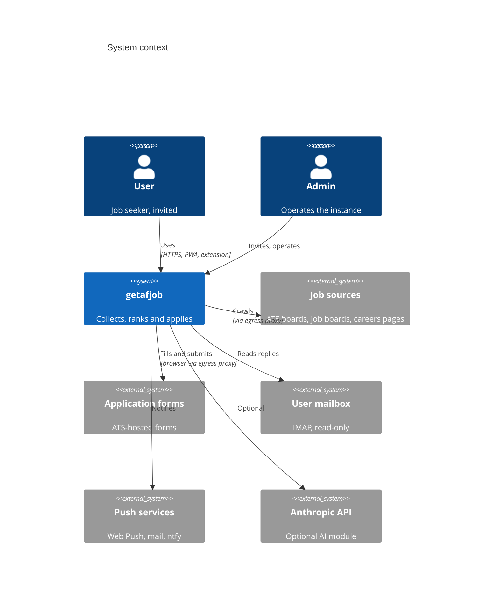
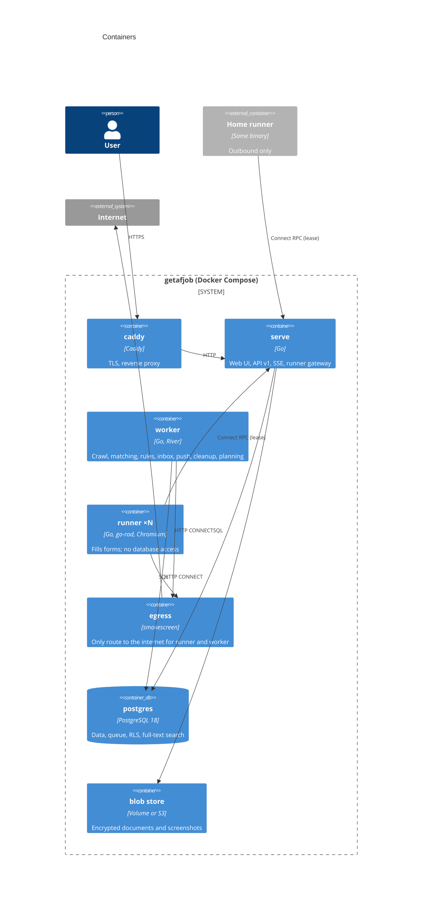
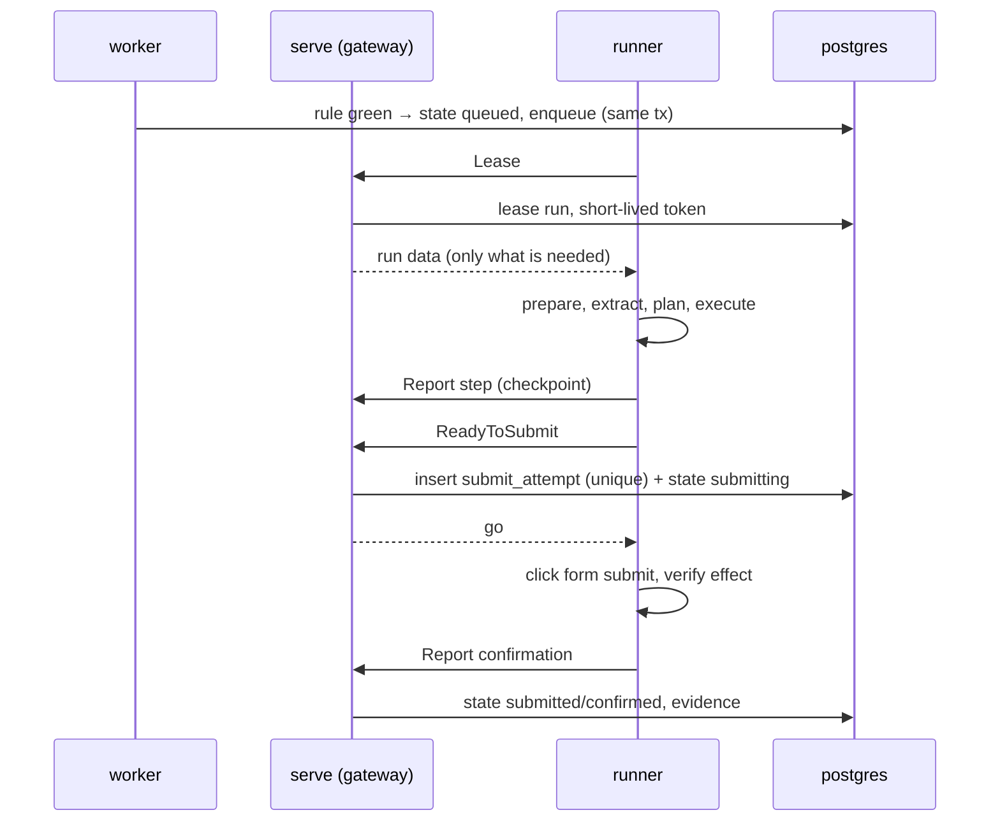

# Architecture

arc42 structure; decisions are in [adr/](adr/README.md). Diagrams use Mermaid (C4).

## 1. Introduction and goals

getafjob collects job postings, ranks them per user and fills out application forms in a real browser, without
disguise and, by default, without AI. Invite-only, several users, self-hosted.

Quality goals, in order:

1. **Correctness of applications**: never invented data ([0013](adr/0013-provenance-for-every-form-value.md)),
   never twice ([0014](adr/0014-submit-register-never-twice.md)), never a silent failure.
2. **Security and privacy**: tenant isolation, encrypted personal data, isolated runners, no SSRF.
3. **No disguise**: humans handle checks meant for humans ([0015](adr/0015-humans-handle-checks-no-disguise.md)).
4. **Operability**: one server, Docker Compose, tested backups, observable.
5. **Responsiveness**: dashboard p95 < 200 ms.

## 2. Constraints

Go only (no Node toolchain), PostgreSQL 18, Docker Compose on Linux, MIT license, public repository, English code
and docs with an English/German UI.

## 3. Context

## 4. Solution strategy

Modular monolith in Go, one binary with roles ([0002](adr/0002-modular-monolith-one-binary-with-roles.md)), ports
and adapters per module ([0003](adr/0003-ports-and-adapters-module-layout.md)), PostgreSQL as the only stateful
system incl. the queue ([0004](adr/0004-postgresql-pgx-sqlc-goose.md), [0005](adr/0005-river-job-queue.md)),
server-rendered UI ([0009](adr/0009-server-rendered-ui-templ-htmx.md)), isolated runners behind a gateway
([0007](adr/0007-runner-isolation-and-gateway.md)) and an egress proxy ([0008](adr/0008-egress-proxy.md)).

## 5. Building blocks

| Module | Responsibility |
|---|---|
| `identity` | invitations, passkeys, magic links, sessions, roles, audit log |
| `profile` | profile, documents, certificates, answer bank, text blocks, CV variants, preferences, setup assistant |
| `discovery` | sources, crawl, companies, boards, global job index, snapshots, dedupe, closings |
| `matching` | per-user filters, score with reasons, decision |
| `application` | state machine, autonomy rule, runs, handoffs, submit register, evidence |
| `runner` | browser (go-rod), engine, ATS adapters, portals |
| `tracking` | inbox (IMAP) → rules → status suggestions |
| `notify` | Web Push, mail, ntfy, daily summary |
| `assist` | API for the browser extension |
| `ai` | optional Planner, Drafter, Extractor, Classifier |
| `platform` | config, logging, OpenTelemetry, crypto, database, queue, blob, HTTP, netguard |

## 6. Runtime

**Application run:** the application state machine (`discovered → matched → queued → running ⇄ needs_input →
submitting → submitted → confirmed → interview | rejected | offer | withdrawn`, plus `skipped`, `parked`, `failed`,
`submit_unknown`) drives runs. Each run: prepare → extract → plan → execute → verify, with a checkpoint (JSON +
screenshot) per step.

**Crawl:** the worker fetches all sources in parallel, then upserts company boards before job boards, so a
job-board copy of a company job is counted as a duplicate and a company board that appears later replaces the
job-board entry (merge, old link kept in `alt_urls`). Every change is a snapshot. A job that a complete source no
longer lists is closed at once; one from a capped source (search, page limit) after 21 days unseen; a failing source
closes nothing. Sources are applicant tracking systems (one board per company), job boards and the career sites of
large companies; every request names itself as `getafjob/<version>` and goes through the egress proxy. The crawl is a
River job on the `crawl` queue (one at a time, at most one waiting), scheduled every `GETAFJOB_CRAWL_INTERVAL` and
started by hand with `getafjob admin crawl`; migrate applies River's schema after the own migrations.

Sources that list jobs without text get one detail request per new job, at most 300 per crawl and 100 per source;
stored descriptions are never fetched again. Sitemaps (Meta) list only job URLs as stubs: a known open job is just
seen again, a new one becomes a posting from the schema.org `JobPosting` on its page. Careers pages are read the same
way; links into supported systems name a company's board (`sources.DetectBoards`).

Greenhouse, Ashby, Lever and Personio boards are fetched conditionally (`If-None-Match`, `If-Modified-Since`). On
304 the open jobs of the board are only marked as seen and nothing closes. The worker stores ETag, Last-Modified,
last crawl and error code per board only after the whole crawl succeeded, so a failed crawl never hides changes;
a failed fetch keeps the last validators.

**Board discovery:** after each crawl a River job looks for the own boards of up to 30 companies that appear only on
job boards: first the boards their links point to, then slugs guessed from the company name (Greenhouse, Ashby,
Lever, Recruitee, Workable, Personio), each fetched once without retries. A board is added (`origin = 'discovered'`)
only if it lists one of the company's jobs with the same `MatchKey`; it then replaces the job-board entries in the
next crawl. `board_checks` remembers every company for 30 days, or one day if no system answered.

**Handoff:** a CAPTCHA, login checkpoint, security code or open question pauses the run; the user gets a Web Push
and continues in the remote browser (CDP screencast); after the hold time the run is parked.

## 7. Deployment

See [0017](adr/0017-compose-deployment-and-hardening.md) and `deploy/`. Networks: `internet` (caddy, egress),
internal `edge` (caddy and serve), `backend` (serve, worker, migrate, postgres), `gateway` (serve and runner), `proxy`
(runner, worker, serve → egress).

## 8. Crosscutting concepts

- **Configuration:** environment variables or `*_FILE` secrets ([configuration.md](configuration.md)).
- **Security:** [security.md](security.md).
- **Sign-in:** invitation, magic link (10 minutes, one use; once a passkey exists only as delayed recovery,
  [0022](adr/0022-mail-link-as-delayed-recovery.md)) or passkey (WebAuthn, discoverable, user verification
  required). Session tokens rotate hourly; adding or removing passkeys and ending other sessions need a sign-in in
  the last 15 minutes ([security.md](security.md#asvs-50-l2-authentication-v6-and-sessions-v7)). The passkey
  script is a TypeScript island in `internal/web/ts`, bundled with the esbuild Go API by `go generate`.
- **Profile:** profile, answers, text blocks and document names are sealed per user; search preferences stay
  readable for the crawler. Documents are typed by content and stored sealed in the blob store. The CV import reads
  PDF or DOCX text in a limited child process (`getafjob extract-text`) and fills only empty fields; the setup
  assistant (`/setup`) walks through CV, contact, work, experience, search and what is still missing.
- **Encryption at rest:** `platform/crypto` seals user secrets and files with a per-user data key (AES-256-GCM,
  associated data = user and purpose); data keys live wrapped in `user_keys` under the master key from a Docker
  secret ([0006](adr/0006-tenant-isolation-rls-and-envelope-encryption.md),
  [key-rotation.md](runbooks/key-rotation.md)). Files go through `platform/blob`: a directory volume (`os.Root`,
  atomic writes) or an S3-compatible bucket, always sealed per user before they leave the process.
- **Texts:** English/German catalogs, backend texts as code + params ([0019](adr/0019-english-first-ui-en-de.md)).
- **Observability:** slog + OpenTelemetry ([0021](adr/0021-observability-slog-opentelemetry.md)). With
  `GETAFJOB_OTEL_ENDPOINT` set, every role exports traces and metrics over OTLP/HTTP; log records carry `trace_id`
  and `span_id`. Spans: HTTP requests (named after the route), River jobs, source fetches (no trace headers to
  third-party sites). Metrics: `http.server.request.duration` per route, `getafjob.queue.job.duration`,
  `getafjob.queue.jobs` (depth per queue and state), `getafjob.crawl.*` (duration, postings per step, changes,
  sources by outcome, source errors by code) and `getafjob.boards.*` (discovery checks, added boards).
- **Testing:** table tests, fuzzing for foreign input, golden tests per source, testcontainers, browser fixtures in
  the runner image, e2e with Compose, architecture tests.

## 9. Decisions

[adr/README.md](adr/README.md)

## 10. Quality requirements

| Scenario | Target |
|---|---|
| Dashboard page | p95 < 200 ms |
| Crash during submit | `submit_unknown`, no second click |
| Value without source | refused by the executor |
| Another user's row | invisible (RLS) |
| Link to an internal address | denied by netguard and the egress proxy |

## 11. Risks and technical debt

- ATS forms change without notice → fixtures + maturity metric per adapter; dry runs before autonomy.
- Hosts that restrict unprivileged user namespaces (AppArmor) need a runner profile; see the deploy runbook.

## 12. Glossary

| Term | Meaning |
|---|---|
| ATS | applicant tracking system (Greenhouse, Lever, Workday …) |
| Handoff | the user takes over a run in the remote browser |
| Provenance | the source of a form value |
| Maturity | measured success rate of an ATS adapter |
